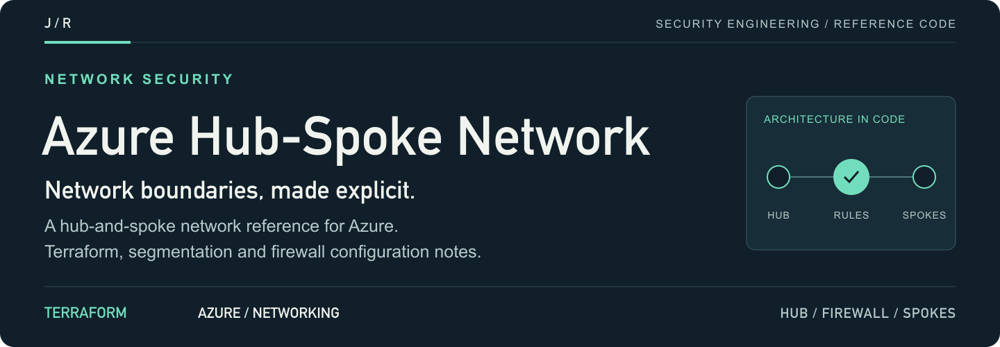
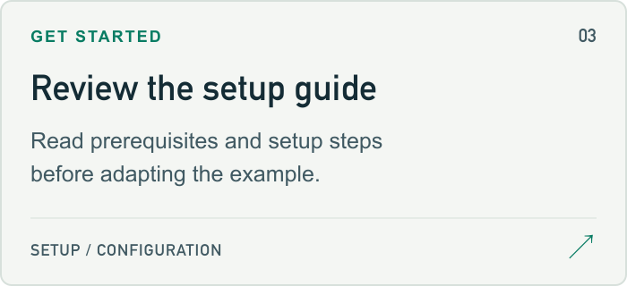
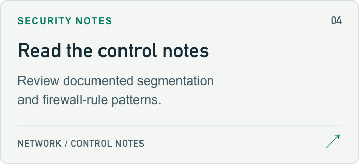

<a id="azure-hub-spoke-network-architecture-with-security"></a>

<a href="#setup-guide">
<picture>
  <source media="(max-width: 600px)" srcset="docs/assets/readme/header-mobile.png">
  
</picture>
</a>

<p>
  <a href="#setup-guide"><strong>Start here ↗</strong></a> &nbsp; / &nbsp;
  <a href="terraform/main.tf">Source</a> &nbsp; / &nbsp;
  <a href="#project-guide">Project guide</a> &nbsp; / &nbsp;
  <a href="https://github.com/jmragsdale">Profile</a>
</p>

An Azure hub-and-spoke reference architecture with Terraform source and documented network-segmentation and firewall patterns.

## Explore the project

Open a card for source, examples or supporting documentation.

<p>
<a href="hub-spoke-architecture.svg">
<picture>
  <source media="(prefers-color-scheme: dark)" srcset="docs/assets/readme/architecture-dark.png">
  
</picture>
</a>
<a href="terraform/main.tf">
<picture>
  <source media="(prefers-color-scheme: dark)" srcset="docs/assets/readme/source-dark.png">
  
</picture>
</a>
<a href="#setup-guide">
<picture>
  <source media="(prefers-color-scheme: dark)" srcset="docs/assets/readme/setup-dark.png">
  
</picture>
</a>
<a href="#security-guide">
<picture>
  <source media="(prefers-color-scheme: dark)" srcset="docs/assets/readme/controls-dark.png">
  
</picture>
</a>
</p>

## Project guide

Enterprise-grade Azure hub-and-spoke network topology with NSGs, Azure Firewall, and micro-segmentation for multi-tier application security.

## 🎯 Overview

Secure, scalable hub-spoke network architecture implementing defense-in-depth principles with centralized security controls, network segmentation, and enterprise connectivity patterns.

## 🏗️ Architecture

<details>
<summary>Architecture flow (text)</summary>

```
                    ┌─────────────────┐
                    │   Hub VNet      │
                    │  ┌───────────┐  │
                    │  │  Azure    │  │
                    │  │  Firewall │  │
                    │  └─────┬─────┘  │
                    └────┬────┬───────┘
                         │    │
              ┌──────────┘    └───────────┐
              │                           │
        ┌─────▼─────┐               ┌─────▼─────┐
        │ Spoke 1   │               │ Spoke 2   │
        │ (Prod)    │               │ (Dev)     │
        │  Web/App  │               │  Web/App  │
        └───────────┘               └───────────┘
```

</details>

## ✨ Features

- 🏢 **Hub-Spoke Topology** - Centralized security and management
- 🔥 **Azure Firewall** - Network and application layer filtering
- 🛡️ **Network Security Groups** - Subnet-level security
- 🔒 **Private Endpoints** - Secure PaaS connectivity
- 🎯 **Micro-segmentation** - Isolated workload tiers
- 📊 **Network Watcher** - Traffic monitoring and diagnostics

<a id="setup-guide"></a>

## 🚀 Quick Start

```bash
# Deploy with Terraform
terraform init
terraform plan
terraform apply
```

<a id="security-guide"></a>

## 🔐 Security Controls

### Network Segmentation
- Web tier: Public-facing (port 443 only)
- App tier: Internal only (from web tier)
- Data tier: Database access (from app tier only)

### Azure Firewall Rules
- Application filtering by FQDN
- Network filtering by IP/port
- Threat intelligence-based filtering

## 💼 Talking Points

- Designed enterprise hub-spoke architecture supporting 1000+ VMs
- Implemented micro-segmentation reducing attack surface by 75%
- Centralized security controls across 50+ applications
- Achieved 99.99% network uptime with redundant design

## 🏷️ Topics

`azure` `networking` `terraform` `hub-spoke` `azure-firewall` `network-security` `enterprise` `micro-segmentation`

---

⭐ **Building enterprise networks?** Star this repo!

<details>
<summary>README visual assets</summary>

[Artwork sources and regeneration notes](docs/assets/readme/README.md).

</details>
